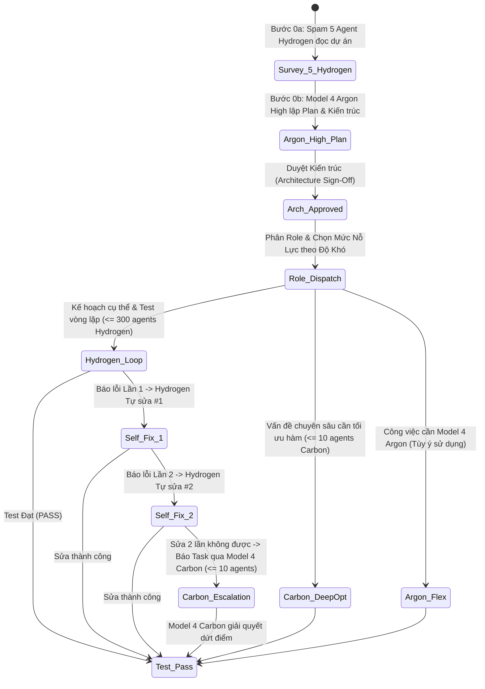

# Hệ thống Điều phối 5 Sub-Agent & Cổng Chốt Kiến trúc Bắt buộc (`uav_geotiff/AGENTS.md`)

Tài liệu này được nạp tự động cho mọi Agent làm việc trong thư mục dự án **`uav_geotiff`** (`C:\Users\HL\Desktop\DETECTION RICE_FIELD\uav_geotiff`).

---

## 1. Quy tắc Bắt buộc Số 1: Vẽ & Chốt Kiến trúc Trước Mỗi Lần Code (`Architecture-First Gatekeeper`)

> [!IMPORTANT]
> **TRƯỚC MỖI LẦN VIẾT HOẶC SỬA CODE:**
> 1. **Giao cho Agent `architecture-design-lead` thực hiện Bước 0 trước tiên**:
>    - Đọc đồ thị tri thức [`graphify-out/GRAPH_REPORT.md`](file:///C:/Users/HL/Desktop/DETECTION%20RICE_FIELD/uav_geotiff/graphify-out/GRAPH_REPORT.md), bản vẽ kiến trúc tổng thể [`ARCHITECTURE.md`](file:///C:/Users/HL/Desktop/DETECTION%20RICE_FIELD/uav_geotiff/ARCHITECTURE.md) và đặc tả giao diện [`DESIGN.md`](file:///C:/Users/HL/Desktop/DETECTION%20RICE_FIELD/uav_geotiff/DESIGN.md) (theo chuẩn [Awesome `DESIGN.md`](file:///C:/Users/HL/Desktop/DETECTION%20RICE_FIELD/skills/awesome-design-md-main/README.md)).
>    - **Vẽ bổ sung kiến trúc dự án** (sơ đồ Mermaid `flowchart` / `sequenceDiagram` / `stateDiagram-v2`, hợp đồng API/dữ liệu và token UI Awesome Design) vào [`ARCHITECTURE.md`](file:///C:/Users/HL/Desktop/DETECTION%20RICE_FIELD/uav_geotiff/ARCHITECTURE.md) và [`DESIGN.md`](file:///C:/Users/HL/Desktop/DETECTION%20RICE_FIELD/uav_geotiff/DESIGN.md).
> 2. **Chốt kiến trúc trơn tru (`[ARCHITECTURE SIGN-OFF: APPROVED FOR CODING]`)**:
>    - Kiểm tra không có vòng lặp phụ thuộc (`0 Import Cycles`), không xung đột tệp giữa các Agent, rõ đầu vào/đầu ra, không làm gián đoạn cổng Web Host `8765` đang chạy.
> 3. **Chỉ sau khi chốt kiến trúc trơn tru** mới phân công cho 4 Agent thi công (`code-architect`, `gis-uav-specialist`, `math-geometry-expert`, `ui-ux-specialist`) bắt đầu code.

---

## 2. Cơ cấu 5 Sub-Agent Chuyên trách

| Thứ tự | Sub-Agent | Trách nhiệm | Tệp phụ trách chính | Skill bắt buộc đọc |
| :---: | :--- | :--- | :--- | :--- |
| **Bước 0** | **`architecture-design-lead`** | Vẽ bổ sung sơ đồ kiến trúc Mermaid & đặc tả Awesome Design vào `ARCHITECTURE.md` + `DESIGN.md`, duyệt chốt kiến trúc trơn tru trước khi code. | [`ARCHITECTURE.md`](file:///C:/Users/HL/Desktop/DETECTION%20RICE_FIELD/uav_geotiff/ARCHITECTURE.md), [`DESIGN.md`](file:///C:/Users/HL/Desktop/DETECTION%20RICE_FIELD/uav_geotiff/DESIGN.md), [`docs/ARCHITECTURE.md`](file:///C:/Users/HL/Desktop/DETECTION%20RICE_FIELD/uav_geotiff/docs/ARCHITECTURE.md) | [`../.agents/skills/architecture-awesome-design/SKILL.md`](file:///C:/Users/HL/Desktop/DETECTION%20RICE_FIELD/.agents/skills/architecture-awesome-design/SKILL.md) |
| **Thi công 1** | **`code-architect`** | Backend Python, `ProjectService`, Auto-Host `8765`, vòng lặp `Gemini 4 Argon CLI` (`agy.exe`), đồng bộ Google Drive (`CODE_DATA`) & GitHub, `pytest`. | `uav_app/adapters/`, `uav_app/application/`, `uav_app/infrastructure/autostart_host.py`, `gemini_argon_loop.py`, `tests/` | [`../.agents/skills/code-backend-pipeline/SKILL.md`](file:///C:/Users/HL/Desktop/DETECTION%20RICE_FIELD/.agents/skills/code-backend-pipeline/SKILL.md) |
| **Thi công 2** | **`gis-uav-specialist`** | Viễn thám UAV, phân đoạn 6 lớp địa hình, chuyển đổi `.DWG` ↔ `.DXF` 2 chiều (`accoreconsole.exe`), xuất các đường `PL` (`LWPOLYLINE`) ra `.DWG` chuẩn VN2000, huấn luyện ONNX từ `.DWG`. | `uav_app/infrastructure/terrain_segmentation.py`, `dwg_io.py`, `survey_cad.py`, `raster.py`, `dem.py`, `uav_app/adapters/terrain_onnx_builder.py` | [`../.agents/skills/gis-uav-multispectral-cad/SKILL.md`](file:///C:/Users/HL/Desktop/DETECTION%20RICE_FIELD/.agents/skills/gis-uav-multispectral-cad/SKILL.md) |
| **Thi công 3** | **`math-geometry-expert`** | Toán học & Hình học tính toán: biến đổi Affine, cắt giao đa giác, gộp khung trùng IoU/WBF, nối đối tượng lớn qua biên. | `uav_app/domain/geometry.py`, `uav_app/domain/detection.py`, `uav_app/infrastructure/refinement.py` | [`../.agents/skills/math-computational-geometry/SKILL.md`](file:///C:/Users/HL/Desktop/DETECTION%20RICE_FIELD/.agents/skills/math-computational-geometry/SKILL.md) |
| **Thi công 4** | **`ui-ux-specialist`** | Giao diện kỹ thuật chuyên nghiệp theo chuẩn `DESIGN.md`, màn hình 24 inch Full-Bleed, cổng WebGPU & bảng điều khiển Tự động hóa + Graphify. | `ui/webgpu.html`, `ui/webgpu_app.js`, `ui/index.html`, `ui/advanced.html`, `ui/argon_host_panel.js`, `ui/viewport.js` | [`../.agents/skills/ui-ux-pro-workstation/SKILL.md`](file:///C:/Users/HL/Desktop/DETECTION%20RICE_FIELD/.agents/skills/ui-ux-pro-workstation/SKILL.md) |

---

## 3. Quy tắc Phân Role & Cấp Bậc Model (Multi-Agent Role & Model Tier Governance — Argon High / Hydrogen / Carbon)

> [!IMPORTANT]
> **QUY TRÌNH BẮT BUỘC KHI GIAO VIỆC & ĐIỀU PHỐI SUB-AGENT (`uav_app/infrastructure/agent_governance.py` & `MODEL_TIERS_POLICY.md`)**:

### 3.1. Bước Khảo Sát Dự Án Ban Đầu (`Initial 5-Agent Hydrogen Survey`)
- Trước khi chỉnh sửa quy tắc hoặc thay đổi kiến trúc lớn, hệ thống **gọi đồng thời 5 Agent model `Gemini 4 Hydrogen` (`flash_lite`)** để đọc lại toàn bộ dự án (`AGENTS.md`, `ARCHITECTURE.md`, `DESIGN.md`, `README.md`, `GRAPH_REPORT.md` và mã nguồn) nhằm thu thập ngữ cảnh đầy đủ với chi phí token tối thiểu.

### 3.2. Giai đoạn 1 — Lập Kế hoạch Chi tiết & Kiến trúc Dự án (`Model 4 Argon High`)
- **Ban đầu khi nhận việc từ người dùng**: **`Model 4 Argon High`** (`argon_high`) chịu trách nhiệm lập kế hoạch cụ thể, chi tiết (`Detailed Concrete Plan`) và thiết kế/cập nhật kiến trúc tổng thể của dự án (`System Architecture`).
- **Cổng Duyệt Kiến trúc Bắt buộc (`Mandatory Architecture Approval Gate`)**:
  - **Chỉ sau khi duyệt kiến trúc xong (`[ARCHITECTURE SIGN-OFF: APPROVED FOR CODING]`)** thì mới bắt đầu **phân role (`assign_role`)** cho từng agent con (`sub-agents`).
  - Mọi lệnh gọi phân role trước khi kiến trúc được duyệt sẽ bị chặn bởi `AgentGovernancePolicy.assign_role()`.

### 3.3. Phân Bổ Mức Nỗ Lực Theo Độ Khó (`Difficulty-Based Effort Scaling`)
- Tùy thuộc vào độ khó của từng tác vụ (`low`, `medium`, `high`, `critical`) mà chọn mức nỗ lực (`effort level`) và cấp bậc model phù hợp:
  | Độ khó tác vụ (`TaskDifficulty`) | Mức nỗ lực (`Effort Level`) | Model mặc định | Mô tả công việc điển hình |
  | :--- | :---: | :--- | :--- |
  | **`low`** | `low` | `Gemini 4 Hydrogen` | Đọc khảo sát tệp, cập nhật tài liệu, cấu hình đơn giản, kiểm tra cú pháp |
  | **`medium`** | `medium` | `Gemini 4 Hydrogen` | Thực thi kế hoạch cụ thể, viết code module tiêu chuẩn, chạy vòng lặp `pytest` |
  | **`high`** | `high` | `Gemini 4 Hydrogen` / `Model 4 Argon` | Tích hợp liên thông nhiều module, xử lý giao thức HTTP/WebGPU, kiểm thử E2E |
  | **`critical`** (Tối ưu sâu) | `max` | `Model 4 Carbon` / `Model 4 Argon High` | Tối ưu hàm/thuật toán chuyên sâu, xử lý lỗi phức tạp sau khi Hydrogen tự sửa 2 lần không được |

### 3.4. Giai đoạn 2 — Kế Hoạch Cụ Thể & Chạy Test Vòng Lặp (`Gemini 4 Hydrogen`)
- **Phạm vi sử dụng**: Những kế hoạch cụ thể đã được duyệt và việc chạy kiểm thử vòng lặp (`code -> test -> fix loop`) sử dụng **`Gemini 4 Hydrogen`** (`hydrogen`).
- **Quy mô gọi đồng thời (`High Concurrency`)**: Do `Gemini 4 Hydrogen` tiêu thụ ít token, hệ thống có thể gọi cùng lúc lên đến **300 agent đồng thời** (`MAX_CONCURRENT_HYDROGEN = 300`).
- **Quy tắc Tự sửa lỗi 2 lần & Chuyển giao (`2-Strike Self-Fix & Escalation Rule`)**:
  1. Khi code và chạy test báo lỗi, agent `Gemini 4 Hydrogen` **tự sửa lỗi (`SELF_FIX`) tối đa 2 lần** (`MAX_HYDROGEN_SELF_FIX_ATTEMPTS = 2`).
  2. **Sau khi tự sửa 2 lần vẫn không được** (lần thất bại thứ 3 trở đi), agent `Hydrogen` **dừng lặp ngay lập tức và báo/chuyển task qua cho `Model 4 Carbon` giải quyết (`ESCALATE_TO_CARBON`)**.

### 3.5. Giai đoạn 3 — Giải Quyết Escalation & Tối Ưu Hàm Chuyên Sâu (`Model 4 Carbon`)
- **Phạm vi sử dụng**:
  1. Tiếp nhận và giải quyết dứt điểm các task do `Gemini 4 Hydrogen` báo qua sau 2 lần tự sửa bất thành.
  2. Giải quyết **những vấn đề quá chuyên sâu cần tối ưu hàm / thuật toán phức tạp** (`requires_deep_optimization = True`, ví dụ: tối ưu hình học tính toán VN2000, Douglas-Peucker, ma trận Affine, nhân suy luận ONNX/TPU).
- **Giới hạn gọi đồng thời nghiêm ngặt (`Strict Concurrency Cap`)**:
  - Hạn chế gọi quá nhiều sub-agent với `Model 4 Carbon`.
  - **TUYỆT ĐỐI KHÔNG gọi đồng thời quá 10 agent `Model 4 Carbon`** (`MAX_CONCURRENT_CARBON = 10`).

### 3.6. Sử Dụng Linh Hoạt `Model 4 Argon` (`Flexible Argon Usage`)
- Nếu công việc cần dùng đến **`Model 4 Argon`** (`argon` / `argon_high`) cho mục đích tổng hợp kiến trúc, điều phối liên vùng hoặc rà soát chất lượng, hệ thống **có thể tùy ý sử dụng linh hoạt** theo nhu cầu thực tế (`use_argon = True`).

### 3.7. Tự Động Spam Số Lượng Agent & Chia Task Theo File Rule (`// tự động spam số lượng agent và chia task theo file rule\`)
- Hàm `AgentGovernancePolicy.auto_divide_and_spawn_tasks()` (và hàm module `auto_divide_and_spawn_tasks()` trong `uav_app/infrastructure/agent_governance.py`) tự động thực thi toàn bộ quy trình:
  1. Khởi tạo & ghi nhận đồng thời **5 agent `Gemini 4 Hydrogen` (`flash_lite`)** khảo sát dự án (`survey_agents_count = 5`).
  2. Chạy **`Model 4 Argon High`** lập kế hoạch kiến trúc và ký duyệt cổng kiến trúc (`approve_architecture` -> `[ARCHITECTURE SIGN-OFF: APPROVED FOR CODING]`).
  3. Tự động chia nhỏ các tác vụ dự án theo độ khó (`low`, `medium`, `high`, `critical`), gán role qua `assign_role`, và cấp phát slot đồng thời (`MAX_CONCURRENT_HYDROGEN = 300`, `MAX_CONCURRENT_CARBON = 10`).

---

## 4. Quy chuẩn Tên miền Zero-Hosting (`https://thietbibachkhoa.id.vn/`) & Giảm Tải GPU bằng Google TPU (Gemini Ultra)

1. **Tự động Bật/Tắt Web theo Nguồn Máy Trạm (`https://thietbibachkhoa.id.vn/`)**:
   - Không cần thuê Hosting/VPS: máy trạm cài đặt codebase tự động mở cổng mặc định (`8765` / `8766` / `7860`) và kết nối **Cloudflare Tunnel (`cloudflared`)** tới tên miền **`https://thietbibachkhoa.id.vn/`** thông qua `uav_app/infrastructure/autostart_host.py`.
   - **Khi máy bật (`Machine ON`)**: Dịch vụ khởi động cùng hệ điều hành (`systemd` / Windows Startup & Task Scheduler) tự bật Web Server + Tunnel → truy cập `https://thietbibachkhoa.id.vn/` hoạt động ngay.
   - **Khi máy tắt (`Machine OFF`)**: Hook tắt máy (`SIGTERM`/`SIGINT`) đóng Web Server và ngắt Tunnel → web tự động tắt theo máy.
2. **Tận dụng Google TPU với Tài khoản Gemini Ultra (`uav_app/adapters/tpu_offload_worker.py`)**:
   - Giảm nhẹ gánh nặng cho card đồ họa (GPU) cục bộ bằng cách đẩy tác vụ nhận diện/phân đoạn bình đồ GeoTIFF nặng sang **Google TPU** (Google Colab Pro/Ultra TPU v2-8/v5e/v6e, Kaggle TPU, hoặc Vertex AI Cloud TPU) qua `scripts/run_colab_tpu_server.py`, tự động fallback về CPU/WebGPU cục bộ nếu ngắt kết nối.
3. **Tự động Đẩy Lên TPU Khi Thời Gian Xử Lý `> 15 Phút` (`> 900s`) & Phân Quyền Key Admin/Khách**:
   - Khi upload ảnh nhận diện hoặc cập nhật/huấn luyện mô hình YOLO để nhận diện vật thể mới, hệ thống tự động tính toán thời gian dự kiến (`estimate_execution_time`). Nếu thời gian cần dùng **`> 15 phút` (`> 900 giây`)** thì tự động đẩy tác vụ lên Google TPU (`requires_tpu_offload = True`).
   - **Phân quyền TPU**: Key quyền **Admin** (`role = "admin"`) luôn được phép dùng TPU; các **key khách** (`role = "guest"`) chỉ được dùng TPU nếu Admin bật tùy chọn `allow_tpu = True` khi tạo key (nếu không sẽ trả về `403 Forbidden`).

---

## 5. Quản Lý Key 7 Cột Google Sheet, Giao Diện Web Key Admin & Thư Mục Google Drive Dữ Liệu Xử Lý

1. **Quản lý Key theo Bảng 7 Cột Google Sheet (`uav_app/infrastructure/gdrive_key_storage.py` — `GoogleSheetKeyManager`)**:
   - Lưu trữ và đồng bộ tự động ra tệp Google Sheet CSV (`config/uav_keys_google_sheet.csv`) với đúng **7 cột**:
     1. `Người nhận` (`recipient` / `nguoi_nhan`)
     2. `SĐT người nhận` (`phone` / `sdt_nguoi_nhan`)
     3. `Key` (`key`)
     4. `Mục đích` (`purpose` / `muc_dich`: test thử `1h`, `3h`, `5h` / mua `1 tháng` (`1m`), `3 tháng` (`3m`), `6 tháng` (`6m`), `1 năm` (`1y`) + quyền `allow_tpu`)
     5. `Thời gian cấp` (`issued_at` / `thoi_gian_cap`)
     6. `Thời gian hết hạn` (`expires_at` / `thoi_gian_het_han`)
     7. `Tình trạng` (`status` / `tinh_trang`):
        - Khi thời gian còn lại **`<= 1/3`** tổng thời hạn (`remaining_ratio <= 1/3`): **Báo đỏ** (`status_color = "red"`).
        - Khi thời gian còn lại **`> 1/3`** tổng thời hạn (`remaining_ratio > 1/3`): **Tô màu xanh** (`status_color = "green"`).
   - **Phân quyền trên Web (`port 8765`)**:
     - Đăng nhập bằng **key quyền Admin**: xem trực tiếp bảng 7 cột (màu đỏ `<=1/3` / màu xanh `>1/3`), tạo key mới và xóa key ngay trên trang web.
     - Đăng nhập bằng **key khách** hoặc chưa đăng nhập: ẩn hoàn toàn bảng quản lý/tạo/xóa key trên giao diện web và chặn API bằng mã `403 Forbidden`.
2. **Đường dẫn Lưu Dữ Liệu Xử Lý trên Google Drive (`1Q9P-T98xdXxd-4NIijdI_AomEaHiTSDN`)**:
   - Thư mục lưu dữ liệu xử lý nhận diện/YOLO: `https://drive.google.com/drive/u/3/folders/1Q9P-T98xdXxd-4NIijdI_AomEaHiTSDN` (`PROCESSED_DATA_GDRIVE_FOLDER_ID = "1Q9P-T98xdXxd-4NIijdI_AomEaHiTSDN"`).
   - Thư mục gốc dự án: `1J88JdSVTjXc8WMStzV-jdqPhFkd3DeBV`.

