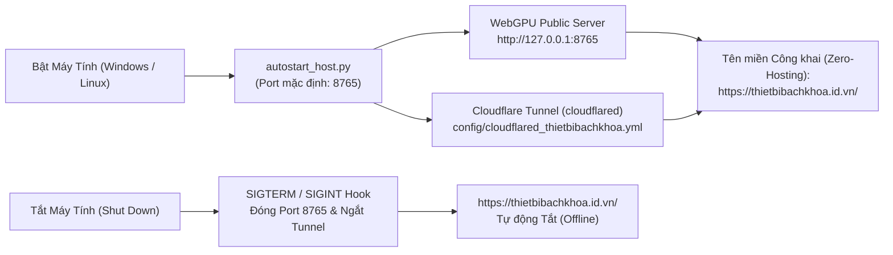

# Hướng Dẫn Thiết Lập Tên Miền `https://thietbibachkhoa.id.vn/` Không Cần Thuê Hosting (Tự Động Bật/Tắt Theo Máy Trạm)
# Zero-Hosting Power-Coupled Setup Guide for `https://thietbibachkhoa.id.vn/`

Tài liệu này hướng dẫn chi tiết cách gắn tên miền **`https://thietbibachkhoa.id.vn/`** trực tiếp vào máy tính đã cài đặt codebase **`UAV_GeoTIFF_WebGPU_Survey_VN2000`** mà **không cần đăng ký hay thuê Hosting / VPS trả phí**.

---

## 1. Nguyên Lý Hoạt Động (Power-Coupled Zero-Hosting Architecture)

1. **Không Cần Thuê Hosting (`Zero Hosting`)**:
   - Chính máy tính cá nhân / máy trạm của bạn đóng vai trò là máy chủ Web chạy trên cổng mặc định đã cài trong codebase (`Port 8765` cho Cổng WebGPU, `Port 8766` cho Trạm Studio 5 Bước, và `Port 7860` cho Docker).
   - **Cloudflare Tunnel (`cloudflared`)** tạo đường hầm bảo mật từ máy của bạn lên mạng biên Cloudflare và trỏ thẳng tên miền `https://thietbibachkhoa.id.vn/` về `http://127.0.0.1:8765` (hoàn toàn miễn phí, không cần mở port modem/router, không cần IP tĩnh).
2. **Khi Máy Tính Bật Lên (`Machine ON -> Web ONLINE`)**:
   - Ngay khi máy tính khởi động (trước cả khi đăng nhập nhờ Windows Task Scheduler `OnStartup` hoặc Linux `systemd`), kịch bản tự khởi động sẽ:
     1. Mở Web Server cục bộ tại cổng mặc định `8765` (`python -m uav_app.adapters.webgpu_public_server --port 8765`).
     2. Khởi chạy đường hầm `cloudflared tunnel --config config/cloudflared_thietbibachkhoa.yml run`.
   - Người dùng truy cập `https://thietbibachkhoa.id.vn/` sẽ vào được trang web ngay lập tức.
3. **Khi Máy Tính Tắt Đi (`Machine OFF -> Web OFFLINE`)**:
   - Khi bạn tắt máy (`Shut down`), hệ điều hành gửi tín hiệu `SIGTERM` / `SIGINT` cho `uav_app/infrastructure/autostart_host.py`, tự động đóng cổng `8765` và ngắt đường hầm Cloudflare.
   - Tên miền `https://thietbibachkhoa.id.vn/` lập tức ngừng truy cập đúng theo trạng thái tắt của máy.



---

## 2. Các Bước Cài Đặt 1 Lần Duy Nhất Trên Máy Tính Của Bạn

### Bước 1: Trỏ Nameserver của `thietbibachkhoa.id.vn` về Cloudflare (Miễn phí)
1. Đăng nhập tài khoản [Cloudflare Dashboard](https://dash.cloudflare.com/) (gói Free `0đ`).
2. Bấm **Add a domain** → nhập `thietbibachkhoa.id.vn` → chọn gói **Free**.
3. Cập nhật 2 Nameserver của Cloudflare vào trang quản lý tên miền `.id.vn` của bạn.

### Bước 2: Đăng nhập `cloudflared` và Tạo Đường Hầm Cố Định Trên Máy
Chạy các lệnh sau 1 lần duy nhất trong Terminal / PowerShell trên máy tính của bạn:

```bash
# 1. Đăng nhập tài khoản Cloudflare chứa tên miền thietbibachkhoa.id.vn
cloudflared tunnel login

# 2. Tạo đường hầm cố định tên là uav-thietbibachkhoa-tunnel
cloudflared tunnel create uav-thietbibachkhoa-tunnel

# 3. Gắn bản ghi DNS CNAME tự động từ thietbibachkhoa.id.vn vào đường hầm
cloudflared tunnel route dns uav-thietbibachkhoa-tunnel thietbibachkhoa.id.vn
cloudflared tunnel route dns uav-thietbibachkhoa-tunnel www.thietbibachkhoa.id.vn
```

### Bước 3: Kiểm tra Tệp Cấu Hình `config/cloudflared_thietbibachkhoa.yml`
Tệp cấu hình đã được tạo sẵn tại `config/cloudflared_thietbibachkhoa.yml` (hoặc sinh tự động qua `python3 -m uav_app.infrastructure.autostart_host --generate-config`):

```yaml
tunnel: uav-thietbibachkhoa-tunnel
credentials-file: /etc/cloudflared/uav-thietbibachkhoa-tunnel.json
protocol: quic
no-autoupdate: true

ingress:
  - hostname: thietbibachkhoa.id.vn
    service: http://127.0.0.1:8765
  - hostname: www.thietbibachkhoa.id.vn
    service: http://127.0.0.1:8765
  - hostname: studio.thietbibachkhoa.id.vn
    service: http://127.0.0.1:8766
  - service: http_status:404
```

### Bước 4: Kích Hoạt Tự Động Bật Khi Mở Máy & Tự Tắt Khi Tắt Máy

#### Trên Windows (Máy trạm Khảo sát Chính):
Mở PowerShell với quyền Administrator và chạy:
```powershell
powershell -ExecutionPolicy Bypass -File .\scripts\install_windows_autostart.ps1 -Port 8765 -Domain "thietbibachkhoa.id.vn"
```
Hoặc chạy trực tiếp kịch bản khởi động:
```cmd
.\scripts\start_thietbibachkhoa_windows.bat
```

#### Trên Linux (Ubuntu / Debian Workstation):
Cài đặt 2 dịch vụ `systemd` đã chuẩn bị sẵn trong `deploy/systemd/`:
```bash
sudo cp deploy/systemd/thietbibachkhoa-web.service /etc/systemd/system/
sudo cp deploy/systemd/thietbibachkhoa-tunnel.service /etc/systemd/system/
sudo systemctl daemon-reload
sudo systemctl enable --now thietbibachkhoa-web.service thietbibachkhoa-tunnel.service
```
Hoặc chạy kịch bản quản lý vòng đời:
```bash
./scripts/start_thietbibachkhoa_linux.sh
```

---

## 3. Kiểm Tra Trạng Thái Tên Miền & Máy Chủ

```bash
# Kiểm tra cấu hình Autostart & Domain Lifecycle
python3 -m uav_app.infrastructure.autostart_host --status

# Kiểm tra API Health & Domain Status khi Server đang chạy
curl http://127.0.0.1:8765/api/health
curl http://127.0.0.1:8765/api/domain-status
```
