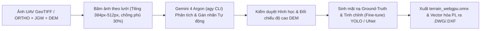

# UAV GeoTIFF Studio & Cổng WebGPU Khảo Sát Địa Hình 6 Lớp (Chuẩn VN2000)

Giải pháp tích hợp **Trạm Workstation Khảo sát UAV** và **Cổng WebGPU Phân đoạn Địa hình 6 Lớp (Zero-GPU Server)** phục vụ đo đạc bản đồ địa hình, số hóa tự động từ bình đồ trực giao (`GeoTIFF` / `ORTHO_*.jpg` + `.jgw` + `DEM_*.tif`) và xuất trực tiếp các đối tượng đường **Polyline (`PL` / `LWPOLYLINE`)** ra tệp bản vẽ **`.DWG` / `.DXF` chuẩn Địa chính – Địa hình VN2000**.

---

## 1. Cổng WebGPU Khảo sát Địa hình 6 Lớp & Trích xuất đường PL trực tiếp ra `.DWG` / `.DXF` chuẩn VN2000

Cổng WebGPU (`ui/webgpu.html` & `uav_app.adapters.webgpu_public_server`) vận hành mô hình học sâu **`TerrainSegUNetLite-WebGPU`** (`models/turbo_yolo/terrain_webgpu.onnx`, opset 17, đầu vào `[1, 3, 512, 512]` → đầu ra `[1, 7, 512, 512]`) ngay trên trình duyệt của người dùng thông qua **WebGPU (WGSL)**, kết hợp truyền phát mô hình mã hóa một lần (**AES-256-GCM Lease Stream**) và quản lý hạn ngạch (**License Key Quota**).

### Bảng 6 Lớp Địa hình & Quy chuẩn Layer CAD VN2000

| Mã lớp | Tên lớp (EN) | Tên hiển thị (VI) | Layer CAD Chuẩn VN2000 | Màu ACI | Kiểu đường (Linetype) | Quy tắc Trích xuất Hình học (`PL` / `LWPOLYLINE`) |
| :---: | :--- | :--- | :--- | :---: | :---: | :--- |
| **1** | `asphalt_road` | **Đường nhựa** | `KS_DUONG_NHUA` + `KS_TIM_DUONG` | `1` (Đỏ) / `2` (Vàng) | `CONTINUOUS` / `CENTER` | Trích xuất trục tim tuyến (`Zhang-Suen Skeleton`) + 2 đường `PL` mép nhựa song song + nhãn `Đ.NHỰA` |
| **2** | `concrete_road` | **Đường bê tông** | `KS_DUONG_BETONG` + `KS_TIM_DUONG` | `7` (Trắng/Đen) | `CONTINUOUS` / `CENTER` | 2 đường `PL` mép bê tông liền nét + đường tim tuyến + nhãn `Đ.BÊ TÔNG` |
| **3** | `dirt_road` | **Đường đất** | `KS_DUONG_DAT` | `30` (Cam nâu) | `DASHED` | 2 đường `PL` mép đường đất nét đứt song song + nhãn `Đ.ĐẤT` |
| **4** | `footpath` | **Đường đi bộ** | `KS_DUONG_DIBO` | `8` (Xám) | `DASHED` | 2 đường `PL` hành lang hẹp nét đứt + nhãn `Đ.ĐI BỘ` |
| **5** | `pond` | **Ao / Hồ** | `KS_AO_HO` | `5` (Xanh dương) | `CONTINUOUS` | Đường `PL` đa giác khép kín làm mượt Douglas-Peucker + râu taluy bờ nước + nhãn `AO` |
| **6** | `masonry_ditch` | **Mương xây** | `KS_MUONG_XAY` | `4` (Xanh lơ) | `CONTINUOUS` | 2 đường `PL` thành mương xây song song theo bề rộng thực tế + nhãn `MƯƠNG XÂY` |

### Quy trình Vector hóa & Xuất trực tiếp `.DWG` / `.DXF`
1. **Giữ nguyên Hệ tọa độ Thực địa (VN2000 / UTM)**: Toàn bộ đỉnh điểm `(Easting X, Northing Y)` được nội suy trực tiếp từ ma trận `Affine` của GeoTIFF hoặc tệp `.JGW` kèm cao độ `Z` nội suy từ tệp `DEM_*.tif` (nếu có).
2. **Làm mượt Hình học & Nối đoạn Đứt gãy**: Áp dụng thuật toán rút gọn đỉnh **Douglas-Peucker**, nối các đoạn hành lang cùng hướng và khử răng cưa pixel trước khi tạo thực thể `LWPOLYLINE` (`PL`).
3. **Xuất `.DXF` & Chuyển đổi Bản địa sang `.DWG`**:
   - Xuất trực tiếp tệp `.DXF` (chuẩn AutoCAD R2010/R2013) chứa đầy đủ bảng Layer, Linetype (`CONTINUOUS`, `DASHED`, `CENTER`), Block ký hiệu địa hình và Text chú dẫn.
   - Chuyển đổi hai chiều `.DWG <-> .DXF` tự động không cần mở giao diện bằng **AutoCAD Core Console (`accoreconsole.exe`)**, **ODA File Converter**, hoặc đẩy thẳng vào bản vẽ đang mở qua **AutoCAD COM Automation** (`uav_app/infrastructure/dwg_io.py` & `autocad_com.py`).

---

## 2. Huấn luyện từ bản vẽ `.DWG` + ảnh `ORTHO_*.jpg` + `.jgw` + `DEM_*.tif`

Mô-đun `uav_app/adapters/terrain_onnx_builder.py` hỗ trợ tự động quét các thư mục dự án khảo sát thực tế để ghép bộ dữ liệu huấn luyện đa phương thức (**CAD Ground-Truth Rasterization**):

### Cấu trúc Bộ dữ liệu Khảo sát Đầu vào (Survey Bundle)
Mỗi phân khu khảo sát bao gồm:
- **Bản vẽ bình đồ đã biên tập**: `*.dwg` hoặc `*.dxf` (chứa các đường `PL`, `LINE`, `POLYLINE`, `TEXT`/`MTEXT` phân lớp địa hình do kỹ sư trắc địa vẽ).
- **Ảnh trực giao UAV độ phân giải cao**: `ORTHO_*.jpg` / `*.tif` kèm tệp tọa độ thế giới `*.jgw` (World File 6 tham số Affine).
- **Mô hình số độ cao (tùy chọn)**: `DEM_*.tif` cùng hệ tọa độ để bổ sung đặc trưng chênh cao địa hình (độ dốc bờ kênh, mặt nước trũng, nền đường đắp).

### Quy trình Tạo Nhãn Tự động từ `.DWG` & Huấn luyện ONNX
1. **Đọc & Chuyển đổi `.DWG`**: Tự động gọi `convert_dwg_to_dxf()` qua `accoreconsole.exe` để trích xuất toàn bộ thực thể hình học (`LWPOLYLINE`, `POLYLINE`, `LINE`, `HATCH`, `TEXT`).
2. **Nội suy Nhãn Đa lớp (Rasterization)**: Ánh xạ tọa độ thực địa VN2000 `(X, Y)` sang tọa độ điểm ảnh `(col, row)` theo ma trận nghịch đảo `.jgw` ở độ phân giải chuẩn (`target_gsd_m = 0.15m/px`), kết hợp nhận diện tên Layer và Text chú giải (`Đ.NHỰA`, `Đ.BÊ TÔNG`, `Đ.ĐẤT`, `AO`, `MƯƠNG`...) để dựng mặt nạ Ground-Truth 7 kênh (0: nền + 6 lớp địa hình).
3. **Trích xuất Đặc trưng Đa kênh trên GPU/CPU**: Đầu vào mạng `TerrainSegUNetLite` tự động tính 8 kênh đặc trưng quang phổ – hình thái ngay trong đồ thị ONNX: `R, G, B, Luminance, ExG (Chỉ số xanh thực vật), EarthWarmth (R-B), ChromaSpread, Sobel Edge Magnitude`.
4. **Lệnh chạy Huấn luyện & Xuất mô hình WebGPU ONNX**:
   ```powershell
   .\.venv\Scripts\python.exe -m uav_app.adapters.terrain_onnx_builder `
       --output models/turbo_yolo/terrain_webgpu.onnx `
       --steps 200 `
       --survey-root "D:\LUUTRU VIEC N\ACAD\Waterpoint_10.3.26"
   ```
   Sau khi chạy, hệ thống sinh ra tệp trọng số `models/turbo_yolo/terrain_webgpu.onnx` (< 1 MB) và tệp siêu dữ liệu `models/turbo_yolo/terrain_webgpu.json` sẵn sàng phục vụ ngay trên Cổng WebGPU.

---

## 3. Vòng lặp Tự động Gán nhãn & Huấn luyện bằng Gemini 4 Argon (`agy` CLI) sau khi băm ảnh (Tiling)

Khi nạp một bình đồ `GeoTIFF` hoặc `ORTHO_*.jpg` mới chưa có bản vẽ `.DWG` mẫu, hệ thống hỗ trợ **Vòng lặp Tự huấn luyện Chủ động (Active Auto-Labeling & Training Loop)** kết hợp cùng **Gemini 4 Argon (`agy` CLI)**:



### Các bước vận hành Vòng lặp `agy` CLI (`uav_app/infrastructure/gemini_argon_loop.py`)
1. **Bước 1 — Băm ảnh có bảo toàn tọa độ (Geo-referenced Tiling)**:
   - Hệ thống cắt ảnh lớn thành các ô nhỏ (`Tile`) kích thước `384x384` hoặc `512x512` pixel với độ chồng phủ `30%`, lưu kèm `manifest` tọa độ thực địa và mặt nạ `NoData` trong `outputs/geotiff_runs/`.
2. **Bước 2 — Gọi tác tử Gemini 4 Argon (`agy` CLI) gán nhãn tự động**:
   - Ngay sau khi hoàn tất băm ảnh, bộ điều phối `gemini_argon_loop.py` (kết nối qua API `/api/argon/...` trong `uav_app/adapters/autostart_and_argon_routes.py`) kích hoạt **`agy` CLI (Gemini 4 Argon)** ở chế độ đa phương thức để quét qua danh sách các tile, tự động phân loại và khoanh vùng 6 lớp địa hình (`asphalt_road`, `concrete_road`, `dirt_road`, `footpath`, `pond`, `masonry_ditch`) cũng như cây trồng/công trình.
   - Gemini 4 Argon kết hợp suy luận ngữ cảnh không gian (hình thái tuyến đường, kết cấu bê tông/nhựa, bờ kè mương xây, phản xạ mặt nước ao hồ) với dữ liệu độ cao `DEM` để loại bỏ nhiễu bóng râm và mái nhà.
3. **Bước 3 — Tự động Huấn luyện Bổ sung & Cập nhật ONNX**:
   - Các nhãn sinh ra từ vòng lặp `agy` CLI được hợp nhất với kho dữ liệu `.DWG` hiện có để huấn luyện tăng cường (`Incremental Fine-tuning`) bằng `terrain_onnx_builder.py` / `turbo_yolo.py`, tự động cập nhật `models/turbo_yolo/terrain_webgpu.onnx` cho những lần suy luận tiếp theo.

---

## 4. Chế độ Tự động mở cổng Web Host khi bật máy tính Windows & tự đóng khi tắt máy

Mô-đun `uav_app/infrastructure/autostart_host.py` cùng hai kịch bản `start_web_host_on_boot.bat` và `stop_web_host.bat` giúp máy trạm Windows hoạt động như một **Máy chủ WebGPU Khảo sát Tự động (Zero-Touch Appliance)** — tự động mở cổng Web Host (`0.0.0.0:8765`) chạy ngầm ngay khi bật máy/đăng nhập Windows và tự động đóng an toàn khi tắt máy:

### Cách 1: Bật/Tắt trực tiếp trên Giao diện Quản trị hoặc Kịch bản `.bat`
- **Khởi chạy dịch vụ Auto-Host chạy ngầm (Port `8765`)**:
  ```powershell
  .\start_web_host_on_boot.bat
  ```
- **Dừng dịch vụ Auto-Host ngay lập tức**:
  ```powershell
  .\stop_web_host.bat
  ```
- **Chạy Trạm Workstation Cục bộ (`http://127.0.0.1:8767`)**:
  ```powershell
  .\START_UAV_STUDIO.cmd
  ```
- **Chạy Cổng WebGPU Công khai kèm HTTPS Cloudflare Tunnel (`Port 8780`)**:
  ```powershell
  .\run_public_webgpu.bat
  ```

### Cách 2: Cơ chế Tự khởi động ngầm cùng Windows (`shell:startup` VBScript) & Tự đóng khi Tắt máy
1. **Tự động mở cổng khi bật máy (`enable_autostart_on_boot`)**:
   - Khi bật chế độ **Tự mở cổng Web Host khi bật máy** trên giao diện (hoặc gọi `enable_autostart_on_boot()` trong `uav_app/infrastructure/autostart_host.py`), hệ thống tự động tạo tệp `UAV_WebGPU_AutoHost.vbs` trong thư mục Khởi động của Windows (`%APPDATA%\Microsoft\Windows\Start Menu\Programs\Startup\UAV_WebGPU_AutoHost.vbs`).
   - Khi Windows khởi động, `WScript.Shell` kích hoạt `start_web_host_on_boot.bat` ở chế độ ẩn hoàn toàn (`WindowStyle = 0`), mở cổng `0.0.0.0:8765` cho toàn mạng LAN (`http://<IP-LAN>:8765`) mà không làm hiện cửa sổ đen CMD gây vướng màn hình.
2. **Tự động đóng an toàn khi tắt máy (Graceful Shutdown)**:
   - Khi bạn chọn **Shut down** hoặc **Restart** Windows, hệ điều hành gửi tín hiệu kết thúc phiên đến tiến trình Python (`uav_app.adapters.webgpu_public_server`), tự động lưu trạng thái hạn ngạch License Key, giải phóng socket cổng `8765`/`8767`/`8780` và xóa tệp khóa `.uav_lease.lock` trước khi máy tắt hoàn toàn.

---

## 5. Hướng dẫn Đẩy lên GitHub và Triển khai Cloud / Local

Dự án đã được cấu hình sẵn `.gitignore`, `Dockerfile`, `render.yaml` và kịch bản tự động `push_to_github.bat` để bạn đẩy mã nguồn kèm mô hình WebGPU ONNX (`models/turbo_yolo/terrain_webgpu.onnx`) lên GitHub chỉ với một cú nhấp chuột.

### 5.1. Đẩy Dự án lên GitHub bằng `push_to_github.bat`
1. Tạo một Repository mới (Trống) trên GitHub, ví dụ: `https://github.com/<username>/uav-geotiff-webgpu.git`.
2. Nhấp đúp chạy tệp **`push_to_github.bat`** tại thư mục gốc của dự án (hoặc chạy trong Terminal):
   ```powershell
   .\push_to_github.bat
   ```
3. Kịch bản sẽ tự động:
   - Kiểm tra cấu hình `git config user.name` và `user.email` (tự động thiết lập nếu chưa có).
   - Hỏi đường dẫn URL GitHub Repository nếu `origin` chưa được gắn.
   - Tự động `git add -A`, tạo bản `commit` cho các thay đổi mới nhất và đẩy lên nhánh chính bằng lệnh `git push -u origin main`.

> **Lưu ý về `.gitignore`**: Tệp `.gitignore` đã loại bỏ hoàn toàn `.venv/`, `node_modules/`, `outputs/`, `.work/`, các tệp tạm (`*.bak`, `*.tmp`, `*.log`, `project_state.json`, `.uav_lease.lock`), nhưng **luôn giữ lại** 3 tệp cốt lõi của Cổng WebGPU:
> - `models/turbo_yolo/terrain_webgpu.onnx`
> - `models/turbo_yolo/terrain_webgpu.json`
> - `models/turbo_yolo/demo_terrain_6_classes.tif`

### 5.2. Triển khai Local (Máy trạm Windows)
```powershell
# 1. Cài đặt môi trường Python (.venv) và thư viện Node.js (onnxruntime-web, geotiff)
.\SETUP_UAV_STUDIO.cmd

# 2. Chạy kiểm thử tự động (Pytest + Playwright UI)
.\.venv\Scripts\python.exe -m pytest -q --disable-warnings

# 3. Khởi động Trạm Workstation (Port 8767) hoặc Cổng WebGPU Công khai (Port 8780)
.\START_UAV_STUDIO.cmd
# hoặc
.\run_public_webgpu.bat
```

### 5.3. Triển khai Đám mây (Cloud Zero-GPU: Render / HuggingFace Spaces / Docker / Railway)
Vì toàn bộ quá trình suy luận mạng nơ-ron diễn ra trên **GPU trình duyệt của khách hàng (WebGPU)**, máy chủ Cloud chỉ cần gói Python siêu nhẹ (`cryptography` ~5 MB để mã hóa luồng ONNX AES-256-GCM) và hoàn toàn **không cần thuê GPU đắt đỏ**:

- **Triển khai qua Render.com (Miễn phí với `render.yaml`)**:
  1. Đẩy dự án lên GitHub bằng `push_to_github.bat`.
  2. Đăng nhập [Render.com](https://render.com) → chọn **New +** → **Blueprint** → kết nối tới GitHub Repository của bạn.
  3. Render tự động đọc `render.yaml` và `Dockerfile`, khởi tạo dịch vụ `uav-survey-webgpu-portal` kèm mật khẩu quản trị `UAV_ADMIN_PASSWORD`.
- **Triển khai bằng Docker bất kỳ đâu**:
  ```bash
  docker build -t uav-webgpu-portal .
  docker run -d -p 7860:7860 -e UAV_ADMIN_PASSWORD="mat_khau_admin_cua_ban" uav-webgpu-portal
  ```
  Sau khi container chạy, mở trình duyệt tại `http://localhost:7860` để sử dụng Cổng WebGPU Khảo sát Địa hình 6 Lớp.


---

## 6. Quy tắc Phân Role Đa Tác Tử (Argon High / Hydrogen / Carbon), Tên Miền `https://thietbibachkhoa.id.vn/` & Google TPU Offloading

### 6.1. Quy tắc Phân Role & Cấp Bậc Model (`AGENTS.md`, `MODEL_TIERS_POLICY.md`, `uav_app/infrastructure/agent_governance.py`)
- **Bước Khảo sát Ban đầu**: Gọi đồng thời **5 agent `Gemini 4 Hydrogen`** đọc lại toàn bộ dự án.
- **Giai đoạn 1 — Lập Plan & Kiến trúc (`Model 4 Argon High`)**: Ban đầu khi giao việc, `Model 4 Argon High` lập kế hoạch cụ thể chi tiết và lên kiến trúc dự án. **Chỉ sau khi duyệt kiến trúc xong (`approve_architecture`)** mới bắt đầu phân role (`assign_role`) cho từng agent con, tùy thuộc vào độ khó (`low`, `medium`, `high`, `critical`) mà chọn mức nỗ lực khác nhau.
- **Giai đoạn 2 — Kế hoạch Cụ thể & Chạy Test Vòng lặp (`Gemini 4 Hydrogen`)**: Dùng `Gemini 4 Hydrogen` (cho phép gọi cùng lúc lên đến **300 agent đồng thời**). Khi code/test báo lỗi thì tự sửa tối đa **2 lần** (`MAX_HYDROGEN_SELF_FIX_ATTEMPTS = 2`); sau khi sửa 2 lần không được thì báo task qua cho **`Model 4 Carbon`** giải quyết.
- **Giai đoạn 3 — Tối ưu Hàm Chuyên sâu (`Model 4 Carbon`)**: Xử lý các bài toán quá chuyên sâu cần tối ưu hàm/thuật toán và các task chuyển lên từ Hydrogen, giới hạn **không gọi đồng thời quá 10 agent `Model 4 Carbon`** (`MAX_CONCURRENT_CARBON = 10`).
- **Sử dụng Linh hoạt `Model 4 Argon`**: Tùy ý sử dụng khi công việc cần đến `Model 4 Argon`.

### 6.2. Thiết lập Tên Miền `https://thietbibachkhoa.id.vn/` Không Cần Thuê Hosting (Tự Bật/Tắt Theo Máy)
- Xem hướng dẫn chi tiết tại [`DOMAIN_SETUP_THIETBIBACHKHOA.md`](DOMAIN_SETUP_THIETBIBACHKHOA.md).
- Hệ thống gắn trực tiếp cổng mặc định của máy trạm (`8765` / `8766` / `7860`) vào tên miền **`https://thietbibachkhoa.id.vn/`** qua Cloudflare Tunnel (`config/cloudflared_thietbibachkhoa.yml` và `uav_app/infrastructure/autostart_host.py`):
  - **Khi máy bật**: Kịch bản khởi động (`scripts/start_thietbibachkhoa_windows.bat`, `scripts/install_windows_autostart.ps1` hoặc `scripts/start_thietbibachkhoa_linux.sh` / `systemd`) tự động mở Web Server ở cổng `8765` và nối đường hầm ra `https://thietbibachkhoa.id.vn/`.
  - **Khi máy tắt**: Tín hiệu tắt máy (`SIGTERM`/`SIGINT`) đóng Web Server và ngắt đường hầm, web tự động tắt theo máy.

### 6.3. Tận dụng Google TPU với Tài khoản Gemini Ultra để Giảm Nhẹ Tải Card Đồ Họa (`TPU_OFFLOAD_ULTRA_GUIDE.md`)
- Xem hướng dẫn chi tiết tại [`TPU_OFFLOAD_ULTRA_GUIDE.md`](TPU_OFFLOAD_ULTRA_GUIDE.md) và Notebook [`notebooks/Colab_Ultra_TPU_Server_VN2000.ipynb`](notebooks/Colab_Ultra_TPU_Server_VN2000.ipynb).
- Bộ điều hợp `uav_app/adapters/tpu_offload_worker.py` kết nối với máy chủ TPU từ xa (`scripts/run_colab_tpu_server.py`) chạy trên **Google Colab Pro/Ultra TPU (v2-8 / v5e / v6e)**, **Kaggle TPU** hoặc **Vertex AI Cloud TPU**, giúp giảm >90% tải cho card đồ họa (GPU) trên máy trạm cục bộ và tự động fallback về CPU/WebGPU khi ngoại tuyến.
